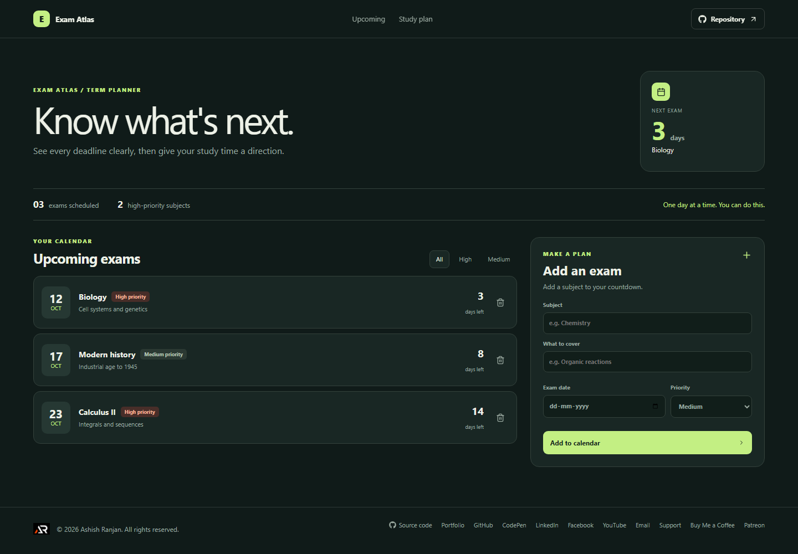

# Exam Atlas

Exam Atlas gathers upcoming exam dates in one countdown planner so study priorities are easy to scan.

Live site: https://a2rp.github.io/exam-countdown-planner/

## How to use it

Add an exam with its subject, date, priority, and an optional coverage note. The calendar sorts exams by date; use the priority filters to narrow the list and confirm before removing an exam.

## Features

- Countdown to the nearest scheduled exam
- Upcoming exam list ordered by date
- Filters for all, high-priority, and medium-priority exams
- Add a subject, exam date, coverage note, and priority
- Confirmation before removing an exam

## Data and limits

Exam records are stored in localStorage in this browser. The starter exams use dates relative to the day the app first creates its sample list.

The planner does not send reminders, create calendar events, or sync data between browsers.

## Run locally

Install Node.js, then run these commands from the project folder:

    npm install
    npm run dev

## Checks and deployment

    npm run lint
    npm run build
    npm run deploy

The deploy command builds the site and publishes the contents of dist to the gh-pages branch. The project is configured for GitHub Pages at https://a2rp.github.io/exam-countdown-planner/.

## Future improvements

These are ideas only and are not implemented yet:

- Add a daily revision checklist per exam (idea, not implemented)
- Export dates to a calendar file (idea, not implemented)
- Set reminder notifications (idea, not implemented)

## Links

- Portfolio: [https://www.ashishranjan.net](https://www.ashishranjan.net)
- GitHub: [https://github.com/a2rp](https://github.com/a2rp)
- CodePen: [https://codepen.io/ash1198](https://codepen.io/ash1198)
- LinkedIn: [https://www.linkedin.com/in/aashishranjan](https://www.linkedin.com/in/aashishranjan)
- Facebook: [https://www.facebook.com/theash.ashish/](https://www.facebook.com/theash.ashish/)
- YouTube: [https://www.youtube.com/@ashishranjan-ashz?sub_confirmation=1](https://www.youtube.com/@ashishranjan-ashz?sub_confirmation=1)
- Email: [mailto:ash.ranjan09@gmail.com](mailto:ash.ranjan09@gmail.com)

## Support

- Support: [https://a2rp-donation-page.netlify.app/](https://a2rp-donation-page.netlify.app/)
- Buy Me a Coffee: [https://buymeacoffee.com/ashishranjan](https://buymeacoffee.com/ashishranjan)
- Patreon: [https://www.patreon.com/ashishranjan](https://www.patreon.com/ashishranjan)